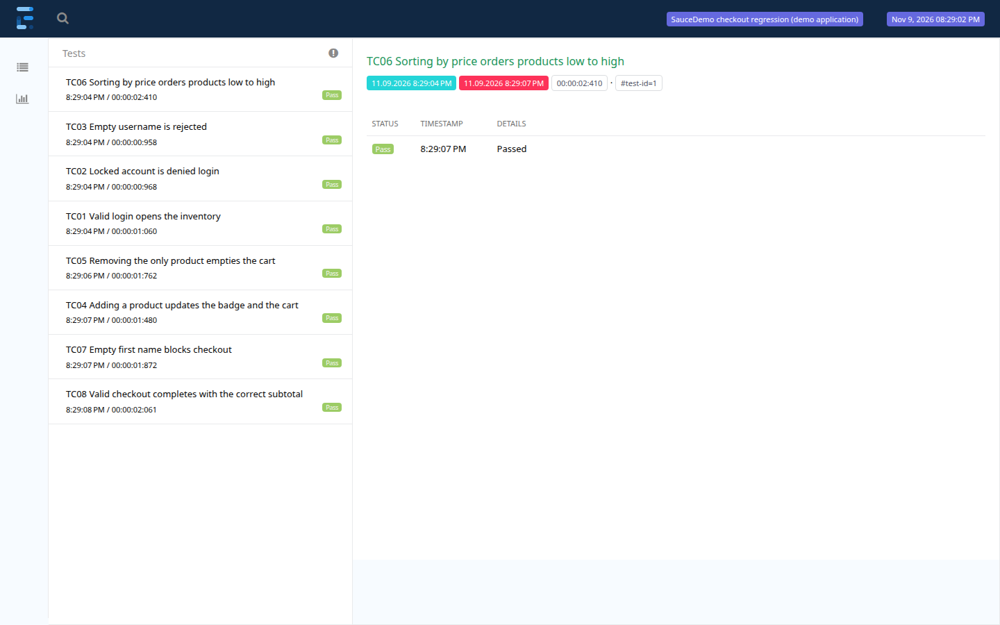
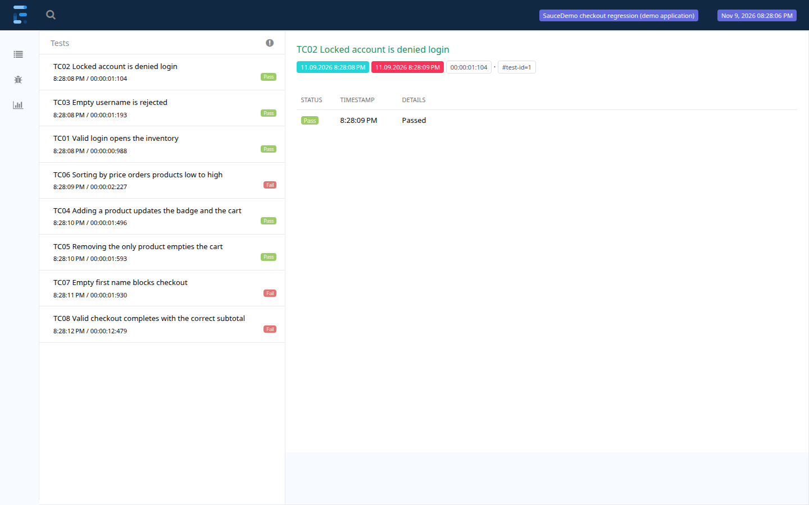

# E-Commerce Checkout Regression

A Selenium regression suite covering login, inventory, cart and checkout on [SauceDemo](https://www.saucedemo.com/), a public practice shop.

This is an independent demo project. SauceDemo takes no real payments, and nothing here reflects production or employment work.



## Stack

Java 21, Maven 3.9, Selenium 4.52, TestNG 7.12, ExtentReports 5.1 and the Page Object Model. Last verified on Chrome 157 on Linux, on 9 November 2026.

## Run it

You need JDK 21, Maven and Chrome. Selenium Manager fetches the matching driver.

```bash
mvn clean test
```

The report is written to `target/test-evidence/checkout-report.html`. A failed test also adds a screenshot to the report and saves the page source as `target/test-evidence/<testName>.html`.

Useful overrides:

```bash
mvn clean test -Dheadless=false
mvn clean test -Dshopper=problem_user
```

## Test cases

| ID | Test | Input | Expected result |
|---|---|---|---|
| TC01 | Valid login | `standard_user` | Inventory is visible and the URL ends in `/inventory.html` |
| TC02 | Locked account | `locked_out_user` | Locked-out error is shown and inventory stays closed |
| TC03 | Required username | Empty username | "Username is required" is shown and inventory stays closed |
| TC04 | Add product | Sauce Labs Backpack | Badge shows 1 and the same item is in the cart |
| TC05 | Remove product | Remove the only cart item | Cart row and badge are both gone |
| TC06 | Sort prices | Price (low to high) | Displayed prices are in ascending numeric order |
| TC07 | Checkout validation | Empty first name | "First Name is required" is shown and checkout does not advance |
| TC08 | Complete purchase | One item, Asha Rao, 560001 | Overview subtotal matches the cart and the order is confirmed |

## How I know the tests can fail

A green run only shows that the tests passed, so I also ran the suite in conditions where the outcome should change.

| Condition | Result | What it shows |
|---|---|---|
| `standard_user`, repeated runs | 8 of 8 pass, about 8 seconds | The suite is stable from a clean browser |
| `performance_glitch_user` | 8 of 8 pass, about 19 seconds | The waits follow the application's state, with no fixed sleeps |
| `problem_user` | 3 of 8 fail | The suite detects the site's seeded defects (below) |
| Every expected value changed on purpose | 8 of 8 fail | No assertion passes regardless of behaviour |

### Defects found with `problem_user`

Run `mvn clean test -Dshopper=problem_user` to reproduce these.

| Test | What happened |
|---|---|
| TC06 | After sorting low to high, the first price is 29.99 where 7.99 is expected |
| TC07 | The error reads "Last Name is required" even though a last name was entered |
| TC08 | Checkout never reaches the overview page, so the subtotal cannot be checked |

The failures below are expected on that account. They are the suite doing its job.



## Testing decisions

**The locked account is a negative test.** `locked_out_user` is meant to be refused, so TC02 passes when login is denied. If that account ever reached the inventory, the test would fail, and that would be a real access-control bug.

**TC06 checks that sorting changed something.** It first asserts that the default order is not already price order. Otherwise a sort control that did nothing could still pass on a list that happened to be sorted.

**Prices are read from the page.** TC08 compares the overview subtotal with the cart's own prices using `BigDecimal`, so no price or tax rate is hard-coded and money is compared exactly.

**Each test gets its own browser.** Tests run in parallel, with one `WebDriver` per thread and no shared cart or session. Any test can run alone, in any order.

**Assertions live in tests.** Page objects expose actions and read state, and tests decide what is correct. That is why a page object can return an error message without judging it.

## Structure

```
src/main/java/com/quantumqa/checkout/
  config/      TestConfig: config.properties with -D overrides
  driver/      DriverManager: one Chrome per test thread
  listeners/   ReportListener: Extent report and failure evidence
  pages/       One class per screen, with no shared base class
  pages/components/  HeaderComponent: cart link and badge
  utils/       Prices: parses displayed prices into BigDecimal
src/test/java/com/quantumqa/checkout/
  data/        TestData: demo accounts and fictional shopper
  tests/       Login, Inventory, Cart and Checkout tests
testng.xml     Suite definition and parallel settings
```

## CI

`.github/workflows/regression.yml` runs weekly and on demand, then uploads the report as a build artifact. It does not run on every push, because the target is a shared public site and its outages should not look like broken commits.

## Known limitations

- It covers Chrome only, with one shopper and one product in the cart.
- It depends on a public site that can change or go down without notice. A failure there needs checking against the site before it is treated as a defect.
- Surefire is pinned to 3.5.x because 3.6 no longer reads TestNG suite XML files.
- Selenium logs a CDP version warning on Chrome 157. The suite does not use CDP, so it has no effect on results.

## What I would add next

Firefox as a second browser, multi-item cart totals including tax, and API-based setup if a target application offered one.

## Credits

The application under test is [SauceDemo](https://www.saucedemo.com/) by Sauce Labs ([source](https://github.com/saucelabs/sample-app-web)). The scope is based on the "E-Commerce Checkout Regression" brief in Sreenidhi Rajakrishnan's Automation Project Build Guide, implemented here in Java and Selenium instead of Playwright.

## Licence

[MIT](LICENSE)
